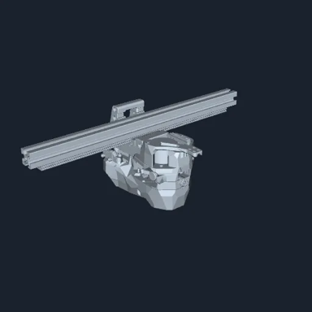
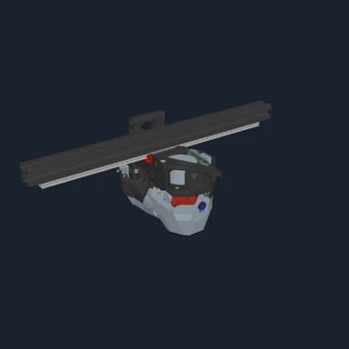

# 10. Görüntüleyici motoru (Faz 5 araştırması)

Tarih: 25 Kasım 2026. Ölçüm kodu: `bench/viewer/` (uygulamaya bağlı değil). Ham sonuçlar: `bench/viewer/results/*.json`.

## Özet

**Öneri: three.js + `occt-import-js` (Web Worker'da), ve STEP'i yüklemede bir kez GLB'ye çevirip R2'de saklamak.**

- Asıl darboğaz motor değil, STEP dönüşümü. 39,5 MB STEP iki motorda da 43 saniye sürüyor ve 1,7 GB WASM belleği kullanıyor. Bunu motor değiştirerek düzeltemeyiz. Dosyayı yüklemede bir kez çevirip sonucu (GLB) saklarsak açılış 43 saniyeden **0,05 saniyeye** iniyor.
- Parça, ad ve renk korununca (montaj ağacı için şart) vtk.js yavaşlıyor. 455 parçalı montajda kare başına 16,3 ms harcıyor (three.js'te 2,2 ms). Mobil tahmininde fark 68,6 ms'ye karşı 4,1 ms. JS belleği 181 MB'a karşı 30 MB. Paket de daha büyük: 232 KB'a karşı 147 KB gzip.
- Seçme (ölçüm, yorum pini), kesit, küçük resim ve GLB üretimi three.js'te hazır parçalarla geliyor. Küçük resim Worker içinde, ana iş parçacığına hiç dokunmadan üretilebiliyor.

## 1. Soru ve yöntem

İki aday:
- **A.** vtk.js (bugünkü canlı görüntüleyici) + `occt-import-js` Web Worker'da.
- **B.** three.js + `occt-import-js` Web Worker'da (ağaç, parça adı, renk korunur).

Adil karşılaştırma için iki motor **aynı Worker'ı** kullanıyor (`bench/viewer/public/occt-worker.js`). Worker dosyayı kendisi indiriyor. STEP'i çevirip typed array'leri kopyasız aktarıyor. A için iki mod ölçüldü:
- `merged`: canlı sitenin bugün yaptığı. Her şey tek PolyData'da: tek renk, ad yok, ağaç yok.
- `parts`: her parça ayrı actor, kendi rengiyle. Montaj ağacı için gereken mod bu. Adil karşılaştırma budur.

B'de `parts` her ağaç düğümü için bir `Group`, her parça için bir `Mesh` demek. `merged` ise renk başına tek çizim. Ölçülenler:

| Ölçü | Tanım |
|---|---|
| Dönüşüm | Worker'da indirme + WASM başlatma + `ReadFile` + typed array'e paketleme |
| WASM bellek | Dönüşüm sonunda WASM yığın boyutu. Yığın küçülmediği için tepe değer budur. Tavan 2 GB. |
| İlk kare (motor) | Veri ana iş parçacığına gelince sahne kurma + ilk çizim (GPU beklenerek, `readPixels`) |
| TBT / en uzun görev | Yükleme boyunca `longtask` gözlemcisi (50 ms üstü kısımların toplamı) |
| Döndürme ms/kare | 120 kare, her karede kamera döner, çizim + GPU beklemesi. Vsync'ten bağımsız gerçek maliyet. |
| Seçme | 20 noktada ortalama. three: `Raycaster`, hızlısı `three-mesh-bvh`. vtk: `vtkCellPicker`, hızlısı donanım seçicisi (`HardwareSelector`). |
| Kesit | Bir kesit düzlemi açıkken ms/kare |
| Küçük resim | 512 px WebP, ekran dışı çizim + kodlama |
| JS heap | Yüklemeden sonra ana sayfanın `usedJSHeapSize` değeri |

**Makine.** Apple M4 (10 çekirdek), 16 GB, macOS 27. Tarayıcı: Playwright 1.65.1 ile Chromium 159, yeni headless mod. GPU: ANGLE Metal, Apple M4. Gerçek GPU kullanıldı, yazılım çizimi değil. Pencere 1280×800, DPR 1. Masaüstü sonuçları 2 koşunun medyanı. Kısılmış koşular tek koşu.

**Mobil tahmini.** CDP ile **4× CPU kısma** uygulandı, gerçek telefonda ölçülmedi. Kısma Worker'a tam yansımıyor: dönüşüm 4× yerine 1,7× yavaşladı. Bu yüzden mobil dönüşüm süresini masaüstü × 4 olarak tahmin ediyoruz. Telefon GPU'su ve bellek sınırı kısmayla taklit edilemez.

## 2. Örnek dosyalar

5 MB'tan büyük dosyalar git'e girmez (`bench/viewer/.gitignore`). Hepsi `sh bench/viewer/fetch-samples.sh` ile indirilir.

| Dosya | Boyut | Ne | Kaynak | Lisans |
|---|---|---|---|---|
| `as1-oc-214.stp` | 0,4 MB | CAx-IF AS1 montajı, renkli, 18 parça | CAx-IF test dosyası, [occt-import-js test klasörü](https://github.com/kovacsv/occt-import-js/tree/main/test/testfiles/cax-if) | CAx-IF kamuya açık test modeli |
| `nist_ftc_10_asme1_ap242-e2.stp` | 1,9 MB | NIST FTC-10 parçası, AP242 | [NIST MBE PMI](https://www.nist.gov/el/systems-integration-division-73400/mbe-pmi-validation-and-conformance-testing/download-free-cad) (`nist-pmi-step-files` zip) | NIST, kısıtsız kullanım, atıf rica ediliyor |
| `MiniSB_Bowden.step` | 13,5 MB | Voron 0.2 MiniSB takım başlığı, 44 parça, renkli | [VoronDesign/Voron-0](https://github.com/VoronDesign/Voron-0/tree/main/CAD/Bowden%20Toolhead) | GPL-3.0 |
| `Stealthburner_CW2.5_Assembly.step` | 39,5 MB | Voron Stealthburner montajı, 455 parça, renkli | [VoronDesign/Voron-Stealthburner](https://github.com/VoronDesign/Voron-Stealthburner/tree/main/CAD) | GPL-3.0 |
| `V0.2R1_Master_Assembly.step` (yalnız stres) | 179 MB | Voron 0.2 tam yazıcı | Voron-0 `CAD/V0.2R1_Master_Assembly_STEP.zip` | GPL-3.0 |
| `dragon.stl` | 1,9 MB | Canlı sitenin demo modeli, 38 bin üçgen | `legacy/public/dragon.stl` | Stanford tarama deposu |
| `stealthburner.stl` | 19,9 MB | Stealthburner'dan üretilen ikili STL, 398 bin üçgen | `node make-stl.cjs` | GPL-3.0 (türev) |

Hedef "~50 MB" idi. Tek parça hâlinde, açık lisanslı ve 50 MB'a en yakın gerçek montaj 39,5 MB'lık Stealthburner oldu. Daha büyüğü (179 MB) ayrıca stres testi olarak denendi.

## 3. Sonuçlar

### 3.1 Dönüşüm (iki motorda aynı)

| Dosya | Boyut | Parça | Üçgen | Dönüşüm (masaüstü) | Mobil tahmini (×4) | WASM bellek |
|---|---|---|---|---|---|---|
| as1-oc-214 | 0,4 MB | 18 | 5 bin | 0,6 s | ~2,5 s | 30 MB |
| NIST FTC-10 | 1,9 MB | 13 | 15 bin | 1,5 s | ~6 s | 75 MB |
| MiniSB | 13,5 MB | 44 | 113 bin | 14,5 s | ~60 s | 463 MB |
| Stealthburner | 39,5 MB | 455 | 398 bin | 43,5 s | ~3 dk | 1.677 MB |
| Voron 0.2 (stres) | 179 MB | 3.092 | **0** | 11,7 dk (Node) | | 2.147 MB (tavan) |

- Süre neredeyse tamamen STEP ayrıştırmasında geçiyor. Üçgenleme payı küçük. Sapmayı (`linearDeflection`) 0,001'den 0,1'e çıkarmak üçgenleri yarıya indirdi ama süreyi belirgin değiştirmedi (Node, 14,5–22 s gürültü içinde).
- Ana iş parçacığı hiç bloklanmadı: bütün koşularda TBT 0 ms. Canlı kod dönüşümü **ana iş parçacığında** yapıyor (`BrepToStlConverter.tsx`), yani sayfa bu süre boyunca donuyor. Worker iki seçenekte de şart.
- Bellek, mobil için asıl engel. 40 MB'lık bir STEP 1,7 GB WASM yığını istiyor. Bu, telefon tarayıcılarının sekme sınırının üstünde (tahmin, telefonda denenmedi). WASM yığınının tavanı 2 GB. 179 MB'lık dosya tavana çarptı. `success: true` döndü, 3.092 parça adı geldi, ama **hiç üçgen yok**. Yani hata sessiz. Kodumuz "üçgen sayısı 0" durumunu dönüşüm hatası saymalı. Tarayıcıda çevrilebilecek STEP boyutu pratikte ~50 MB ile sınırlı.

### 3.2 Motor karşılaştırması: büyük montaj (Stealthburner, 455 parça)

Masaüstü:

| Ölçü | vtk `merged` (bugün) | vtk `parts` | three `parts` | three `merged` |
|---|---|---|---|---|
| Sahne kurma + ilk çizim | 46 ms | 270 ms | 42 ms | 47 ms |
| Döndürme, ms/kare | 1,33 | **16,3** | **2,18** | 1,37 |
| Seçme (temel) | 229 ms | 29 ms | 0,9 ms | 3,5 ms |
| Seçme (hızlı) | 7,0 ms | 141 ms | 0,2 ms (+72 ms BVH kurulumu) | 0,08 ms |
| Kesit açık, ms/kare | 2,4 | 18,4 | 3,2 | 2,2 |
| Küçük resim 512 px | 43 ms | 167 ms | 38 ms | 30 ms |
| JS heap | 75 MB | 181 MB | 30 MB | 59 MB |
| Parça adı / renk / ağaç | yok / yok / yok | var / var / kendi kodumuz | var / var / var | renk var, ad yok |

4× CPU kısma (mobil tahmini):

| Ölçü | vtk `parts` | three `parts` |
|---|---|---|
| Sahne kurma + ilk çizim | 871 ms | 116 ms |
| Döndürme, ms/kare | **68,6 (~15 fps)** | **4,1** |
| Seçme (hızlı) | 586 ms | 0,8 ms |
| Kesit açık, ms/kare | 74,8 | 6,6 |
| Küçük resim | 628 ms | 77 ms |

vtk.js'in her actor için sabit bir CPU maliyeti var. Tek actor'da (bugünkü mod) hızlı, ama parçalar ayrılınca maliyet parça sayısıyla büyüyor. three.js'te 455 parça masaüstünde bile 2 ms'nin biraz üstünde. Binlerce parçalı montajlar için `BatchedMesh` var. Bu ölçülmedi.

 

*Soldaki bugünkü canlı yol: tek renk, parça yok. Sağdaki three.js parçalı mod: STEP'teki renkler. Aynı dosya, aynı dönüşüm.*

### 3.3 Küçük ve orta dosyalar

Masaüstünde iki motor da rahat. Fark çoğunlukla seçmede:

| Dosya | Motor | İlk kare (toplam) | ms/kare | Seçme (temel / hızlı) | Kesit ms/kare | JS heap |
|---|---|---|---|---|---|---|
| NIST 1,9 MB | vtk `parts` | 1,67 s | 1,26 | 10,1 / 6,2 ms | 1,32 | 15 MB |
| NIST 1,9 MB | three `parts` | 1,49 s | 1,02 | 1,1 / 0,05 ms | 1,36 | 7 MB |
| MiniSB 13,5 MB | vtk `parts` | 13,7 s | 2,21 | 41 / 17 ms | 2,22 | 38 MB |
| MiniSB 13,5 MB | three `parts` | 14,7 s | 1,21 | 2,1 / 0,09 ms | 1,82 | 10 MB |
| MiniSB, 4× kısma | vtk `parts` | 22,4 s | 4,34 | 167 / 58 ms | 5,62 | 26 MB |
| MiniSB, 4× kısma | three `parts` | 22,1 s | 1,73 | 7,7 / 0,27 ms | 2,49 | 10 MB |

"İlk kare (toplam)" dönüşümü de içerir. İki motor arasındaki fark dönüşümün gürültüsü içinde kalıyor.

### 3.4 STL (ana iş parçacığında, motorun kendi okuyucusuyla)

| Dosya | Motor | İlk kare | ms/kare | Seçme (temel / hızlı) | JS heap |
|---|---|---|---|---|---|
| dragon 1,9 MB | vtk | 38 ms | 1,99 | 20 / 3,5 ms | 13 MB |
| dragon 1,9 MB | three | 35 ms | 1,90 | 1,4 / 0,03 ms | 10 MB |
| stealthburner 19,9 MB | vtk | 127 ms | 2,31 | 232 / 7,4 ms | 81 MB |
| stealthburner 19,9 MB | three | 95 ms | 2,42 | 9,3 / 0,04 ms | 55 MB |
| stealthburner, 4× kısma | vtk | 361 ms | 2,07 | 955 / 16 ms | 81 MB |
| stealthburner, 4× kısma | three | 231 ms | 2,33 | 35 / 0,17 ms | 54 MB |

### 3.5 Dönüşümü bir kez yapmak: GLB türevi

Deney (`derivative.html`): STEP'i çevir, three.js sahnesini `GLTFExporter` ile GLB'ye yaz, sonra GLB'yi iki motorla aç. Küçük resmi de bir Worker'da GLB'den üret.

| Dosya | STEP | GLB | GLB gzip | GLB yazma | three GLB açılış | vtk GLB açılış | Worker'da küçük resim |
|---|---|---|---|---|---|---|---|
| as1-oc-214 | 0,4 MB | 0,2 MB | <0,1 MB | 11 ms | 214 ms* | 41 ms | 230 ms* |
| NIST FTC-10 | 1,9 MB | 0,5 MB | 0,2 MB | 11 ms | 22 ms | 38 ms | 91 ms |
| MiniSB | 13,5 MB | 3,9 MB | 1,9 MB | 24 ms | 29 ms | 82 ms | 83 ms |
| Stealthburner | 39,5 MB | 14,9 MB | 6,2 MB | 70 ms | **49 ms** | 385 ms | 99 ms |
| Stealthburner, 4× kısma | | | | 200 ms | 162 ms | 1.424 ms | 179 ms |

\* İlk dosya. Tarayıcının ilk shader derlemesi bu satıra düşüyor.

- STEP'ten açılış 43 s, GLB'den 0,05 s. GLB, STEP'in üçte biri boyutunda ve gzip ile altıda biri. Meshopt ya da quantization ile daha da küçülür; ölçülmedi.
- GLB'de ağaç, parça adları (461 adlı düğüm) ve renkler korunuyor. vtk.js GLB'yi okuyabiliyor ama yazamıyor. vtk'yı seçersek türev için kendi biçimimizi yazmamız gerekir.
- Küçük resim tamamen Worker'da (three.js + `OffscreenCanvas`) 70–120 ms'de üretiliyor. Ana iş parçacığına yük yok. vtk.js render penceresi DOM istediği için bunu yapamıyor.
- Uç nokta hazır: `POST /api/files/{id}/thumbnail` 4c'de yazıldı. Bir `….glb` türevi için aynı kalıp (yalnız `edit`, boyut ve başlık denetimi) uygulanabilir. Bu Worker'da CPU harcamaz, sadece akıtır.

### 3.6 Paket boyutu (görüntüleyici chunk'ı)

`node bench/viewer/bundle-size.mjs`, Vite 8 üretim derlemesi. Her sayfanın kendi parçaları ve ortak yardımcı dahil.

| | Ham | gzip |
|---|---|---|
| vtk.js görüntüleyici (render, kamera, STL okuyucu, hücre seçici, donanım seçici, kesit) | 861 KB | **232 KB** |
| three.js görüntüleyici (render, OrbitControls, STL okuyucu, raycast, kesit) | 588 KB | **147 KB** |
| `three-mesh-bvh` (tembel yüklenir, hızlı seçme) | | +28 KB |
| `occt-import-js.wasm` (yalnız STEP/IGES açılınca, iki seçenekte aynı) | 7,4 MB | 3,0 MB (brotli 2,2 MB) |

GLB türevi olan dosyalarda görüntüleyici 3 MB'lık WASM'ı hiç indirmez. Bu, paylaşılan sayfada ve mobilde en büyük kazanç.

## 4. Sadakat ve araçlar

| Konu | vtk.js | three.js |
|---|---|---|
| Montaj ağacı | Sahne grafiği yok. Ağacı biz tutarız (ad → actor eşlemesi). | `Object3D` hiyerarşisi doğrudan ağaç. Göster/gizle `visible` ile. |
| Parça adı, renk | Actor başına mümkün. Yüz rengi için hücre skaler dizisi gerekir. | `Mesh.name`, malzeme. Yüz rengi geometri grubu ile. Bench kodu bunu yapıyor. |
| Seçme (yorum pini, parça seçimi) | `vtkCellPicker` büyük modelde yavaş (229–955 ms). Donanım seçici hızlı ama parça sayısıyla yavaşlıyor (141–586 ms). | `Raycaster` + `three-mesh-bvh`: 0,04–0,8 ms. Pin için dünya koordinatı ve normal hazır geliyor. |
| Ölçüm (nokta–nokta, kenar) | Widget'lar var (`vtkDistanceWidget` vb.). Stil ve dokunmatik uyumu bize kalır. | Hazır widget yok. Seçme + çizgi + HTML etiket ile birkaç yüz satır. Online3DViewer'da örnek var (MIT). |
| B-rep kenarı, yüz seçimi | `occt-import-js` kenar vermiyor, iki motorda da aynı. Yüz sınırı `brep_faces` üçgen aralığı olarak geliyor. | Aynı. Kenar çizgisi için `EdgesGeometry` (açı eşiği) yeterli görünüyor. |
| Kesit düzlemi | `mapper.addClippingPlane`. Kapak (cap) yok. | `clippingPlanes`. Kapak için stencil örneği var (three örnekleri). |
| Patlatılmış görünüm | Actor konumlarını kendimiz kaydırırız. | Grup konumlarını kaydırırız. Ağaç hazır olduğu için kolay. |
| Dokunmatik | Etkileşim stili dokunmayı destekliyor. Hareket ayarı ve test bizde. | `OrbitControls`: tek parmak döndür, iki parmak yakınlaştır/kaydır hazır (03 §2.2'deki davranış). |
| Küçük resim | Ana iş parçacığında, DOM'da gizli pencere. | `OffscreenCanvas` ile Worker'da. |
| Format desteği | STL, OBJ, PLY, glTF (okuma). 3MF yok. | STL, OBJ, PLY, 3MF, glTF okuma ve glTF yazma. |

**Not (canlı site).** Yükleme alanı ve SEO metinleri 3MF diyor ama canlı görüntüleyici 3MF'i reddediyor (`legacy/src/components/vtk.tsx:327`, `ThumbnailGenerator.tsx:137`). three.js'in `3MFLoader`'ı bu açığı kapatır.

## 5. Taşıma maliyeti

Canlı görüntüleyicinin vtk'ya bağlı kodu ~1.550 satır: `vtk.tsx` 558, `scene.tsx` 386, `ThumbnailGenerator.tsx` 347, `BrepToStlConverter.tsx` 266. Üstüne `app.tsx` (2.002 satır) bu parçaları sarıyor. D15 gereği stüdyo sekmeleri (Görünüm, Işıklar, Çıktı) taşınmıyor. Faz 5 de `app.tsx`'i parçalayıp araçları baştan tasarlıyor. Yani iki seçenekte de kod büyük ölçüde yeniden yazılacak. Motor değişikliğinin ek maliyeti küçük.

| Canlıdaki özellik | vtk'da kalırsak | three'ye geçersek |
|---|---|---|
| STL/OBJ/PLY açma | Taşı (az iş) | Hazır okuyucular (az iş) |
| STEP/IGES | Worker'a taşı, parçalı moda geç (orta) | Aynı Worker, parçalı mod bench'te hazır (az iş) |
| Tel kafes, sıfırla, standart görünümler, yakınlaştır | Taşı (az iş) | Yeniden yaz (az iş, ~150 satır) |
| Izgara, eksen göstergesi | Taşı (az iş) | `GridHelper`, `ViewHelper` (az iş) |
| Küçük resim | Ana iş parçacığında kalır (az iş) | Worker'a taşınır, GLB'den üretilir (orta) |
| Stüdyo sahneleri, ışık, arka plan | Taşınmıyor (D15) | Taşınmıyor (D15) |

Kaba tahmin: three.js ile ilk sürüm (açma, ağaç, seçme, kesit, ölçüm, dokunmatik, küçük resim, GLB türevi) 1 Faz 5 dalgasına sığar. vtk'da kalmak bu dalgadan zaman kazandırmaz. Ağaç, seçme ve parçalı çizim performansı için vtk'da daha fazla kendi kodumuz olur.

## 6. Diğer seçenekler (kısaca)

- **Online3DViewer** (MIT, three.js + `occt-import-js`): B'nin hazır paketlenmiş hâli. Motoru olduğu gibi almak yerine ölçüm, kenar ve yükleyici kodu referans alınabilir. Ayrı aday değil.
- **opencascade.js / kendi OCCT WASM derlememiz:** B-rep kenar ve yüz bilgisi, üçgenleme kontrolü verir. Ama WASM onlarca MB. Ayrıştırma maliyeti de aynı OCCT olduğu için düşmez. Şu an açıkça daha iyi değil. `occt-import-js` terk edilirse geri dönüş yolu bu.
- **Sunucuda dönüşüm** (Cloudflare Containers, ücretli plan): mobilden yüklenen ve 50 MB üstü STEP için tek gerçek çözüm. Free plan Worker'da (10 ms CPU) imkânsız. Şimdilik ertelenir. Türev biçimi (GLB) aynı kalacağı için sonradan eklenebilir.
- **xeokit:** AGPL, SaaS'ta risk (02'de reddedildi). **Ticari SDK'lar** (HOOPS, CAD Exchanger): bu aşamada maliyeti haklı değil.

## 7. Öneri, gerekçe, riskler

**Öneri: B, three.js. Ek olarak dönüşümü bir kez yapıp GLB türevini saklamak.**

Akış:
1. Yükleme biter. Yükleyenin tarayıcısı dosyayı Worker'da çevirir.
2. GLB ve küçük resim üretilir. Küçük resim de Worker'da üretilir.
3. İkisi `edit` yetkisiyle R2'ye yazılır (`….thumb` yanına `….glb`).
4. Görüntüleyici önce GLB'yi açar. GLB yoksa STEP'i yerinde çevirir.

Gerekçe:
1. Ölçülen en büyük fark montajlarda. Parça ve renk korunduğunda vtk.js 7× yavaş (mobil tahmininde 17×) ve 6× bellek kullanıyor. Montaj ağacı Faz 5'in ana aracı.
2. GLB türevi açılışı ~900× hızlandırıyor ve mobilde STEP çevirme zorunluluğunu kaldırıyor. three.js GLB'yi yazabiliyor. vtk.js yazamıyor.
3. Seçme 25–700× hızlı, paket %37 küçük, küçük resim ana iş parçacığına dokunmuyor. Dokunmatik kontroller hazır.
4. Taşıma maliyeti iki seçenekte de benzer. Kod zaten yeniden yazılıyor (D15, Faz 5).

Riskler:
- **`occt-import-js` bakımı:** son sürüm 0.0.23, Aralık 2024. Tek geliştirici. Lisansı LGPL-2.1. Değiştirmeden ayrı WASM dosyası olarak yüklüyoruz; lisans metnini ve değiştirilebilirliği korumak yeterli. Terk edilirse kendi OCCT derlememize geçeriz. Türev biçimi aynı kalır.
- **Bellek tavanı:** ~50 MB üstü STEP tarayıcıda çevrilemeyebilir (2 GB WASM tavanı; 179 MB'lık dosya 11,7 dakika sonra üçgensiz, sessizce boş döndü). Bu dosyalar için türev sunucu dönüşümü gelene kadar yok. Kullanıcıya "küçük resim + indir" gösterilir.
- **Türev, ham dosyanın yerine geçmez:** GLB üçgen ağı. B-rep değil, CAD'de düzenlenemez, ama şekil kopyalanabilir. "Yalnızca görüntüleme" vaadi buna göre yazılmalı (aşağıda karar 2).
- **İstemcinin ürettiği türev:** `edit` yetkili biri bozuk ya da yanıltıcı bir GLB yükleyebilir. Küçük resimdeki gibi yalnız `edit`, boyut sınırı ve GLB başlık denetimi yapılır. Aynı kişi ham dosyayı da değiştirebildiği için yeni bir yetki açığı açılmıyor.
- **Ölçüm sınırı:** Tek makine (M4). Mobil sayılar kısmayla tahmin. Faz 5'te staging'de gerçek telefonla (iOS Safari, orta sınıf Android) doğrulanmalı.

## 8. Senin vermen gereken kararlar

1. **Motor:** three.js'e geçilsin mi? Öneri: evet. Alternatif: vtk.js'te kalmak. Montajlarda yavaş kalır ve türev için kendi biçimimizi yazmamız gerekir.
2. **Yalnızca görüntüleme düzeyi:** Görüntüleyebilir / Yorum yapabilir düzeyine (ve bu düzeydeki linke) ham STEP yerine GLB türevi açılsın mı? Bu D18'deki "sunucu türevi"nin karşılığı olur. Ama GLB'de şekil indirilebilir (B-rep değil). Öneri: evet. Paylaşım penceresinde "3B önizleme, kaynak dosya indirilemez" gibi dürüst bir metinle.
3. **Türev yoksa ne olsun?** (mobilden yükleme, dönüşüm hatası, ~50 MB üstü STEP)
   - (a) "Küçük resim + İndir + Masaüstünde aç" gösterilir. `edit` yetkili biri dosyayı masaüstünde ilk açtığında türev üretilir.
   - (b) Ücretli planla sunucuda dönüşüm (Containers).

   Öneri: şimdilik (a), (b) Q9/Q10'dan sonra.
4. **Tarayıcıda çevrilecek en büyük STEP:** `Entitlements`'ta ayrı bir sınır olsun mu? Öneri: 50 MB. Yükleme sınırı 100 MB kalır (D21). Üstündeki dosyalar yüklenir ama türevi oluşmaz.
5. **Eski dosyalar:** Canlıdaki STEP/STL dosyalarının türevleri nasıl üretilsin?
   - (a) İlk açılışta tembel üretim.
   - (b) Geçişte bir kez, senin makinende çalışan bir script ile. `occt-import-js` Node'da da çalışıyor; script production R2'yi okuyup türev yazacağı için senin onayınla çalışır.

   Öneri: (a), (b) isteğe bağlı.

## 9. Yeniden çalıştırma

```sh
cd bench/viewer
pnpm install --ignore-workspace
sh fetch-samples.sh                  # STRESS=1 ile 179 MB'lık dosya da gelir
pnpm exec playwright install chromium
pnpm build
node run-bench.mjs --runs 2          # masaüstü → results/results-desktop.json
node run-bench.mjs --throttle 4 --modes parts --files nist_ftc_10_asme1_ap242-e2.stp,MiniSB_Bowden.step,Stealthburner_CW2.5_Assembly.step,stealthburner.stl
node run-derivative.mjs              # GLB türevi deneyi → results/derivative.json
node bundle-size.mjs                 # paket boyutları
python3 summarize.py results/results-desktop.json   # medyan tablosu
```

Tek bir durumu tarayıcıda görmek için: `pnpm dev`, sonra `http://localhost:5199/three.html?file=MiniSB_Bowden.step&mode=parts` (ya da `vtk.html`). Sonuç sağ üstte JSON olarak görünür.
